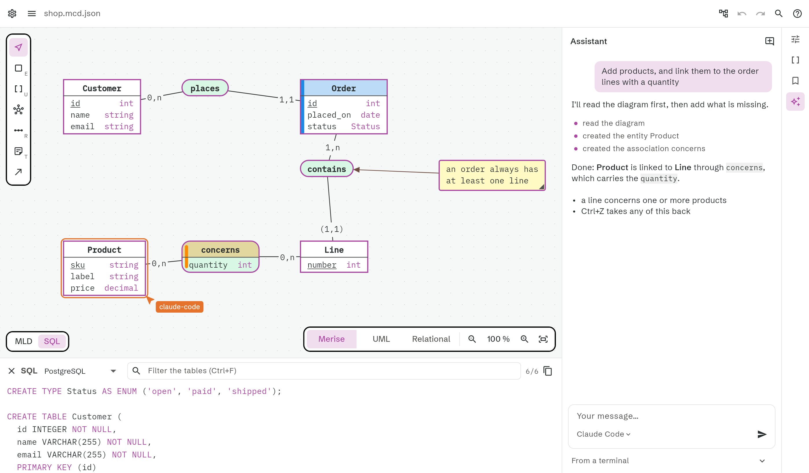
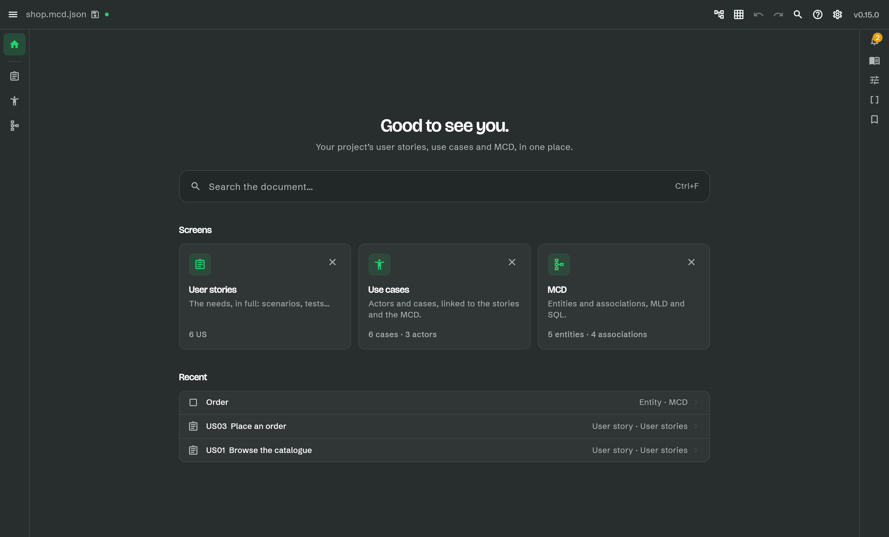
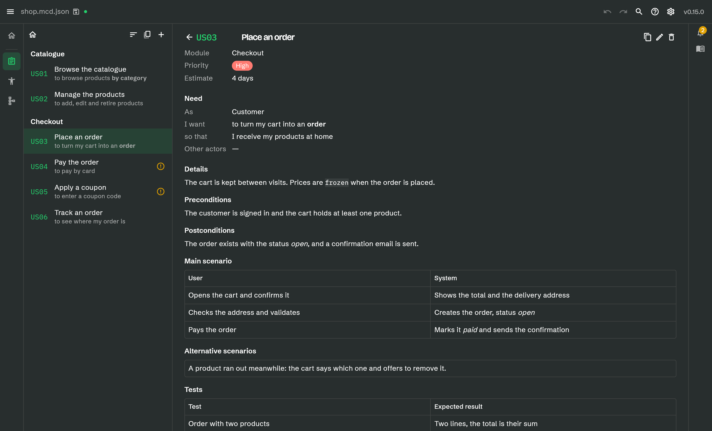
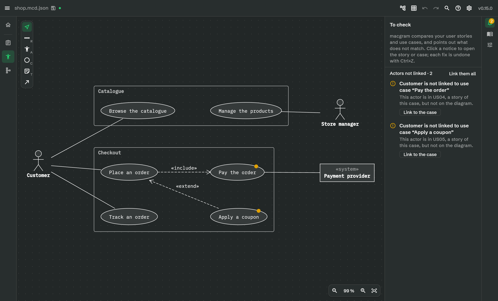
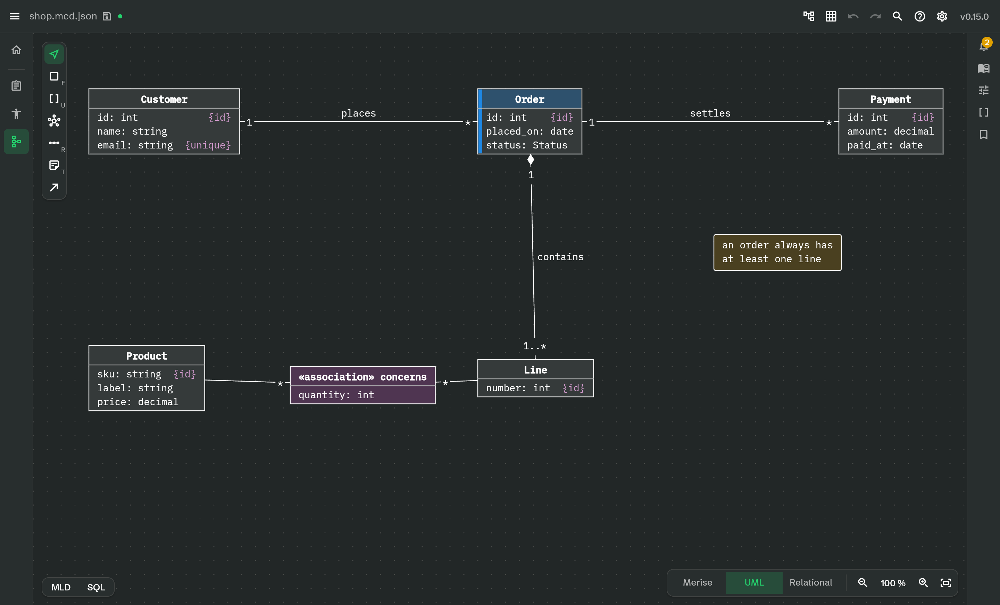
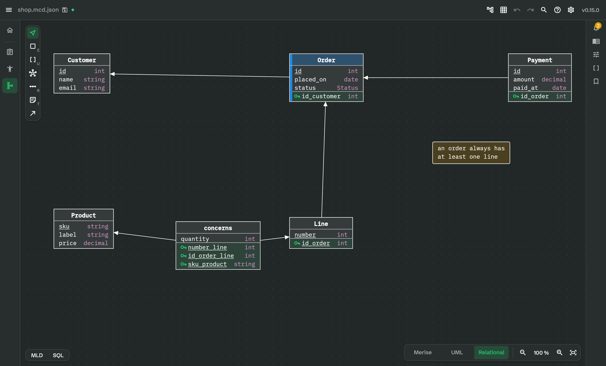
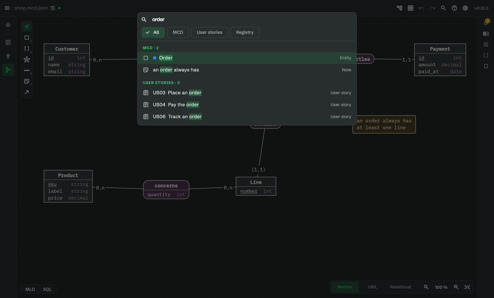
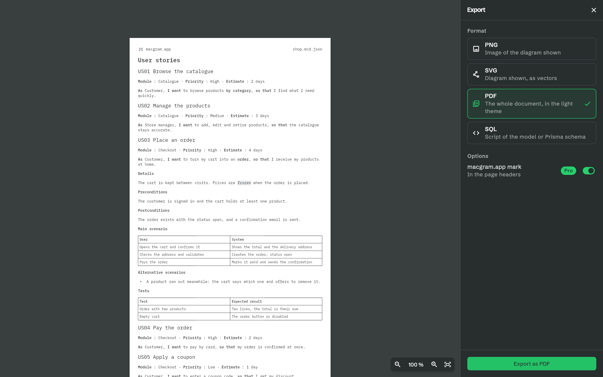

<div align="center">


# macgram

**From user stories to the database: stories, use cases and entity-relationship diagrams (Merise / UML) in one document that versions cleanly with git.**
An alternative to Looping, for Linux and Windows, and in the browser.

[](https://github.com/redyd/macgram-releases/releases/latest)
[](https://github.com/redyd/macgram-releases/releases)

<picture>
  <source media="(prefers-color-scheme: dark)" srcset="screenshot-dark.png">
  
</picture>

</div>

## Download

These links always point to the latest version.

| System | File | |
|---|---|---|
| **Windows** | Installer | [macgram-windows-x64-setup.exe](https://github.com/redyd/macgram-releases/releases/latest/download/macgram-windows-x64-setup.exe) |
| | Portable zip, no installation | [macgram-windows-x64.zip](https://github.com/redyd/macgram-releases/releases/latest/download/macgram-windows-x64.zip) |
| **Linux** | AppImage, any distribution | [macgram-x86_64.AppImage](https://github.com/redyd/macgram-releases/releases/latest/download/macgram-x86_64.AppImage) |
| | Debian, Ubuntu, Mint | [macgram-amd64.deb](https://github.com/redyd/macgram-releases/releases/latest/download/macgram-amd64.deb) |
| | Fedora | [macgram-x86_64.rpm](https://github.com/redyd/macgram-releases/releases/latest/download/macgram-x86_64.rpm) |
| | Archive | [macgram-linux-x64.tar.gz](https://github.com/redyd/macgram-releases/releases/latest/download/macgram-linux-x64.tar.gz) |

Earlier versions are on the [Releases](https://github.com/redyd/macgram-releases/releases) page. There is no macOS build yet.

Nothing to install? [Open the web editor](https://macgram.app/editor). The AI assistant is only in the desktop app.

## Install

**Windows.** Run the installer. It is not signed, so Windows may show "Windows protected your PC": click *More info*, then *Run anyway*.

**AppImage.**

```bash
chmod +x macgram-x86_64.AppImage
./macgram-x86_64.AppImage
```

**Debian, Ubuntu, Mint.**

```bash
sudo apt install ./macgram-amd64.deb
```

**Fedora.**

```bash
sudo dnf install ./macgram-x86_64.rpm
```

**Archive.** Extract it anywhere and run `./macgram`; the binary needs the `lib/` and `data/` folders next to it.

The `.deb` and `.rpm` packages add `macgram` to the application menu and to the `PATH`. A file can be given as an argument: `macgram model.mcd.json`.

## Updates

The app looks for a new version when it starts and offers to install it. Nothing is downloaded without your say.

| Installation | What "Update" does |
|---|---|
| Windows installer | downloads the next installer and runs it |
| AppImage | replaces the AppImage file |
| `.deb`, `.rpm` | downloads the package and installs it (the system asks for your password) |
| Portable zip, `.tar.gz` | opens this page |

## What macgram does

**The analysis**

- **User stories**: "As… I want… so that", priority, estimate, conditions, scenarios and tests, in Markdown, grouped by module and copied as Markdown.
- **Use cases**: actors, cases, modules and links (include, extend, generalisation), with a Rearrange button that keeps crossings low.
- **One registry**: actors and modules are defined once and reused everywhere; rename one and it changes everywhere.
- **To check**: a tab that finds what disagrees between your stories and your cases, and fixes it in a click.
- **A home for each document**: pick the screens you need, find your latest elements, and search everything with `Ctrl+F`, typos forgiven.

**The database**

- **The conceptual model**: entities, binary, n-ary, reflexive or standalone associations, cardinalities, weak entities, enums, notes and annotation arrows.
- **Three views of one diagram**: Merise, UML and relational, sharing the same box positions.
- **The relational model and SQL, live**: the MLD under the diagram, or the `CREATE TABLE` script for PostgreSQL, MySQL / MariaDB, SQLite or SQL Server, or a Prisma schema. Advanced settings (table and column names, defaults, `CHECK`, indexes, `ON DELETE`) go straight into the script.
- **Automatic layout and free placement**: one button moves the boxes to keep links from crossing; place them on the grid or freely (`G`).

**Together**

- **Files made for git**: JSON with one element per line and random ids, so diffs stay readable and branches merge without collisions.
- **Cloud documents** (with a macgram account): edit together live and see who is where, with a version history. Let each friend edit or only read, or turn on a public link; on desktop, paste a link in the Open dialog to join a document.
- **An AI assistant** (desktop): talk to Claude Code, Codex, any OpenAI-compatible API or a local Ollama model and watch it work on the stories, the use cases and the diagram, one undoable step at a time. The CLIs run as already installed and signed in on your machine, and API tokens stay on it. A local MCP server lets an AI started from your terminal join in too.

**In and out**

- **Import**: `.loo` files from Looping open directly; SQL scripts become a diagram (Pro plan).
- **Export screen**: PNG, SVG, SQL, Prisma, or a PDF of the whole document with its stories and diagrams, with a live preview. Images and PDFs carry a small macgram.app mark, which the Pro plan can remove.
- **And the rest**: settings in one place (`Ctrl+,`), right-click menus, undo / redo by screen, copy and paste, strict mode, light, dark or system theme, interface in English or French, release notes after each update.

## Screenshots

| | |
|---|---|
|  |  |
|  |  |
|  |  |
|  | |

## Something wrong?

Open an [issue](https://github.com/redyd/macgram-releases/issues) with your system and the version (it is shown in the toolbar).

## License

macgram is distributed under the MIT license with the *Commons Clause*: free to use, at work too, but not to resell. This repository only holds the files to download.
