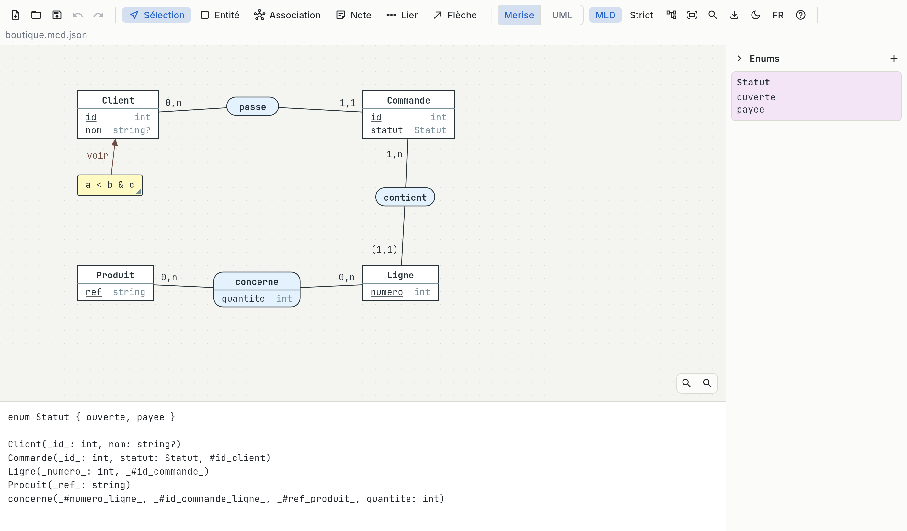

<div align="center">


# macgram

**Un éditeur de MCD (Merise / UML) dont les fichiers se versionnent avec git.**
Une alternative à Looping, pour Linux et Windows.

[](https://github.com/redyd/macgram-releases/releases/latest)
[](https://github.com/redyd/macgram-releases/releases)

<picture>
  <source media="(prefers-color-scheme: dark)" srcset="screenshot-dark.png">
  
</picture>

</div>

## Télécharger

Les liens pointent toujours vers la dernière version.

| Système | Fichier | |
|---|---|---|
| **Windows** | Installeur | [macgram-windows-x64-setup.exe](https://github.com/redyd/macgram-releases/releases/latest/download/macgram-windows-x64-setup.exe) |
| | Zip portable, sans installation | [macgram-windows-x64.zip](https://github.com/redyd/macgram-releases/releases/latest/download/macgram-windows-x64.zip) |
| **Linux** | AppImage, toutes distributions | [macgram-x86_64.AppImage](https://github.com/redyd/macgram-releases/releases/latest/download/macgram-x86_64.AppImage) |
| | Debian, Ubuntu, Mint | [macgram-amd64.deb](https://github.com/redyd/macgram-releases/releases/latest/download/macgram-amd64.deb) |
| | Fedora | [macgram-x86_64.rpm](https://github.com/redyd/macgram-releases/releases/latest/download/macgram-x86_64.rpm) |
| | Archive | [macgram-linux-x64.tar.gz](https://github.com/redyd/macgram-releases/releases/latest/download/macgram-linux-x64.tar.gz) |

Les versions précédentes sont sur la page [Releases](https://github.com/redyd/macgram-releases/releases). Il n'y a pas de version macOS pour l'instant.

## Installer

**Windows.** Lance l'installeur. Il n'est pas signé, donc Windows peut afficher « Windows a protégé votre ordinateur » : clique sur *Informations complémentaires*, puis *Exécuter quand même*.

**AppImage.**

```bash
chmod +x macgram-x86_64.AppImage
./macgram-x86_64.AppImage
```

**Debian, Ubuntu, Mint.**

```bash
sudo apt install ./macgram-amd64.deb
```

**Fedora.**

```bash
sudo dnf install ./macgram-x86_64.rpm
```

**Archive.** Décompresse-la où tu veux et lance `./macgram` ; le binaire a besoin des dossiers `lib/` et `data/` à côté de lui.

Les paquets `.deb` et `.rpm` ajoutent `macgram` au menu d'applications et au `PATH`. Un fichier peut être passé en argument : `macgram modele.mcd.json`.

## Mises à jour

L'application cherche une nouvelle version au lancement et propose de l'installer. Rien n'est téléchargé sans ton accord.

| Installation | Ce que fait « Mettre à jour » |
|---|---|
| Installeur Windows | télécharge l'installeur suivant et le lance |
| AppImage | remplace le fichier AppImage |
| `.deb`, `.rpm` | télécharge le paquet et l'installe (le système demande ton mot de passe) |
| Zip portable, `.tar.gz` | ouvre cette page |

## Ce que fait macgram

- **Le MCD** : entités, associations binaires ou n-aires, cardinalités, identifiants relatifs, enums, notes et flèches d'annotation, en notation Merise ou UML.
- **Le MLD en direct** : le modèle relationnel se génère sous le schéma à mesure que tu le dessines.
- **Des fichiers faits pour git** : du JSON avec un élément par ligne et des identifiants aléatoires, donc des diffs lisibles et des branches qui fusionnent sans collision.
- **Le réarrangement automatique** : un bouton replace les boîtes pour limiter les croisements de liens.
- **L'import Looping** : les fichiers `.loo` s'ouvrent directement.
- **L'export** en PNG et en SVG, fidèle au thème clair ou sombre.
- **Le reste** : annuler / rétablir, copier-coller, recherche par nom, mode strict, interface en français ou en anglais.

## Un souci ?

Ouvre une [issue](https://github.com/redyd/macgram-releases/issues) en précisant ton système et la version (elle est affichée dans la barre d'outils).

## Licence

macgram est distribué sous licence MIT avec la *Commons Clause* : tu peux l'utiliser librement, y compris en entreprise, mais pas le revendre. Ce dépôt ne contient que les fichiers à télécharger.
